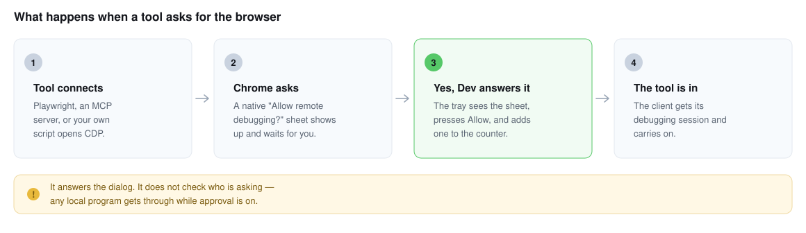
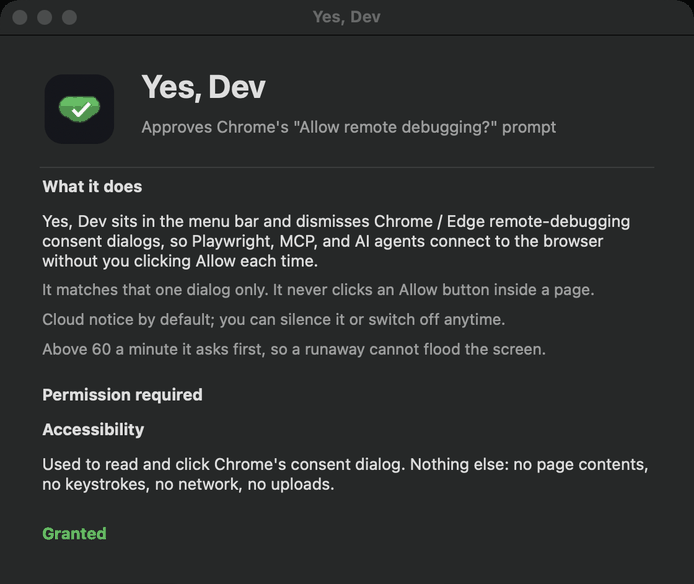
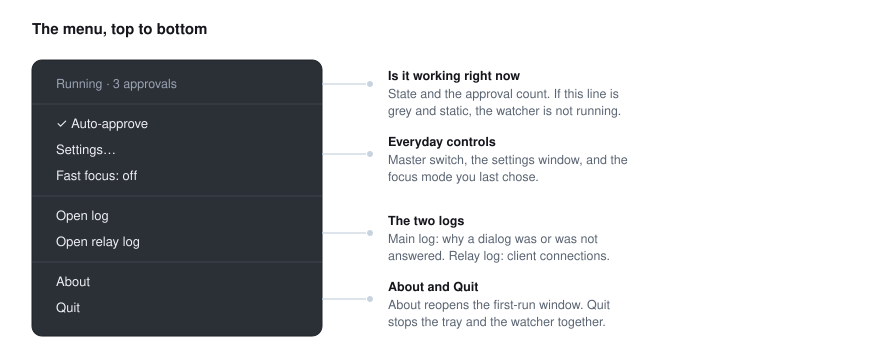
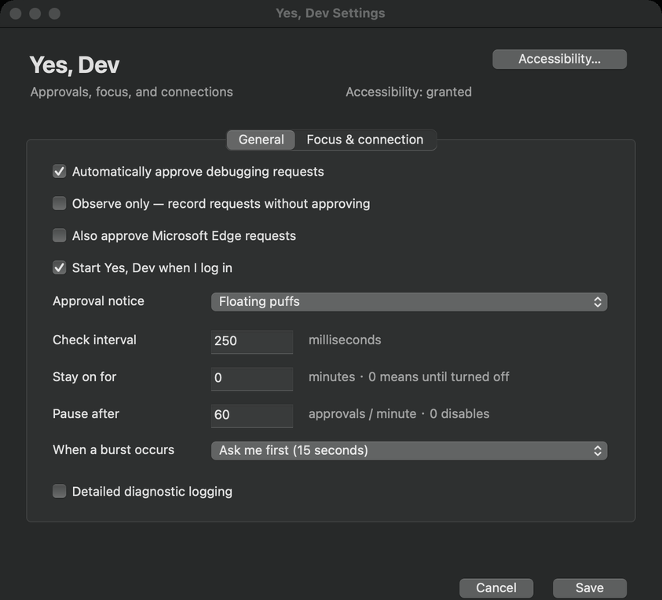
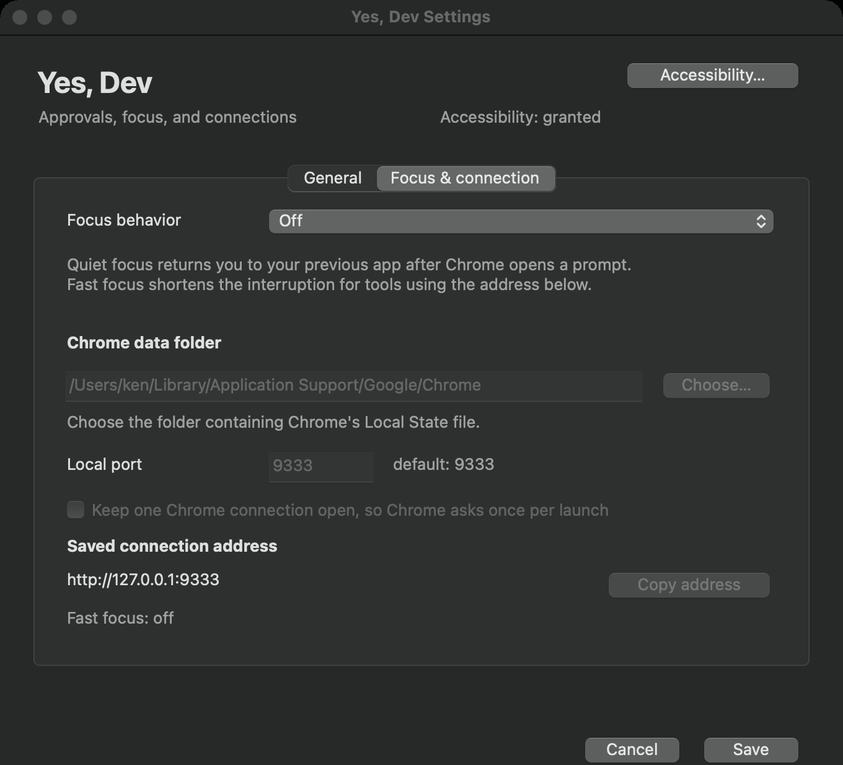

<p align="center">
  
</p>

<p align="center">
  Approve Chrome and Edge remote-debugging prompts from your tray or menu bar.
</p>

Yes, Dev clicks the **Allow remote debugging?** consent sheet, so local automation
tools — Playwright, an MCP server, your own script — connect without waiting for
you to click. Windows and macOS.

> **It answers the dialog. It never checks who asked.** Any local program gets
> through while approval is on, so run it only where that is acceptable.



## Install

**Windows** — [download the ZIP](https://github.com/Kennems/yes-dev/releases/latest),
extract the whole folder somewhere permanent, and run `YesDev.exe`. Keep `app/`
and `runtime/` beside it; Python is bundled. Needs Windows 10/11 x64 and
PowerShell 5.1. The launcher is unsigned, so SmartScreen may ask once.

**macOS** — no signed `.app` is shipped; run from source:

```bash
git clone https://github.com/Kennems/yes-dev.git && cd yes-dev
python3 -m pip install -e .
yesdev
```

Then grant **Accessibility** to that interpreter in System Settings › Privacy &
Security. The menu's **Accessibility** item opens the page.

Full setup: [Windows](docs/windows.md) · [macOS](docs/macos.md)

## What you see

The first-run window says what it does, what it needs, and whether the
permission is already there. **About** in the menu reopens it.



Once it is running, everything lives in one menu:



## Settings

Two tabs. **General** holds the switches you actually touch:



**Focus & connection** only matters if you drive the browser through the relay:



| Setting | What it does |
|---|---|
| **Automatically approve** | Master switch |
| **Observe only** | Log matches, approve nothing — use it to see what would be approved |
| **Include Microsoft Edge** | Also answer Edge dialogs |
| **Approval notice** | Floating puffs, a toast, or silence |
| **Check interval** | Poll rate. 250 ms default; higher means less CPU, slower reaction |
| **Stay on for** | Disarm after N minutes; `0` means until you turn it off |
| **Pause after** | Approvals per minute before self-protection; `0` disables it |
| **When a burst occurs** | Ask first, or stop silently |

Defaults: approval on, Edge off, 250 ms, puffs, no timer, 60 approvals/minute.
At the burst limit it asks **Stop** or **Allow for one hour**; no answer within
15 seconds stops it. **Stop silently** resumes after about a minute.

## Beyond the basics

**Windows — one connection per browser.** Turn on **Keep one Chrome/Edge
connection open** and point your CDP tools at `127.0.0.1:9333` (Chrome) or
`9334` (Edge). Later clients share that connection instead of re-prompting.
[Setup and routing](docs/concurrent-relay.md)

**macOS — focus and relay.** *Quiet focus* hands focus back after Chrome grabs
it; *Fast focus* prepares the return before the prompt appears and requires
connecting through the relay. Both are off by default.
[Focus behaviour](docs/macos.md#focus-behavior)

## When it stops approving

Check the tray is there, **Auto-approve** is ticked, and neither Observe mode nor
a timer is active. Then read the log:

- `%LOCALAPPDATA%\YesDev\yes-dev.log` (Windows) and
  `~/Library/Application Support/YesDev/yes-dev.log` (macOS) — why a dialog was
  or was not answered
- `relay.log` in the same folder — only exists while the relay is on

Settings live in those folders too and survive updates. **Quit the app before
replacing it** — a running copy keeps executing old code.

Only the consent mode behind `chrome://inspect/#remote-debugging` is handled;
command-line remote debugging is a different path. Windows matches English and
Simplified Chinese dialogs, so a renamed browser title needs a code change.

[Troubleshooting](docs/troubleshooting.md)

## Docs

[Windows](docs/windows.md) · [macOS](docs/macos.md) ·
[Windows relay](docs/concurrent-relay.md) · [Troubleshooting](docs/troubleshooting.md) ·
[Architecture](docs/architecture.md) · [Tests](tests/README.md) ·
[Packaging](packaging/README.md) · [Changelog](CHANGELOG.md) ·
[中文说明](README.zh-CN.md)

## License

[MIT](LICENSE). The portable ZIP bundles runtime and dependency licenses.
