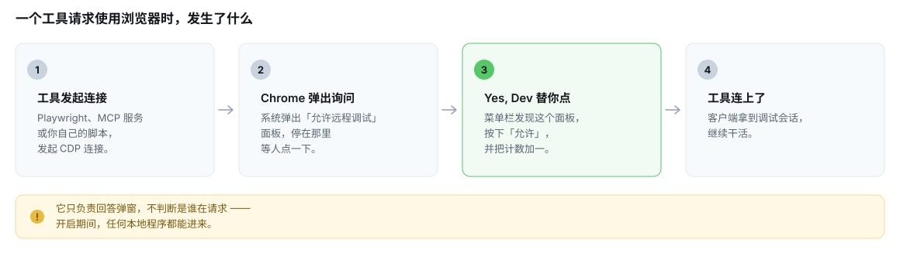
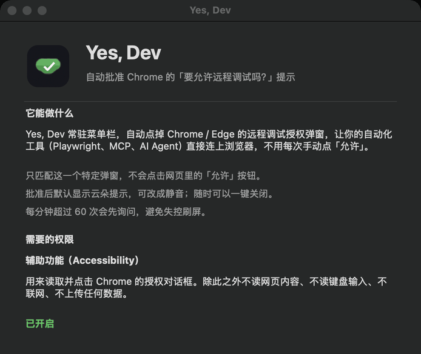
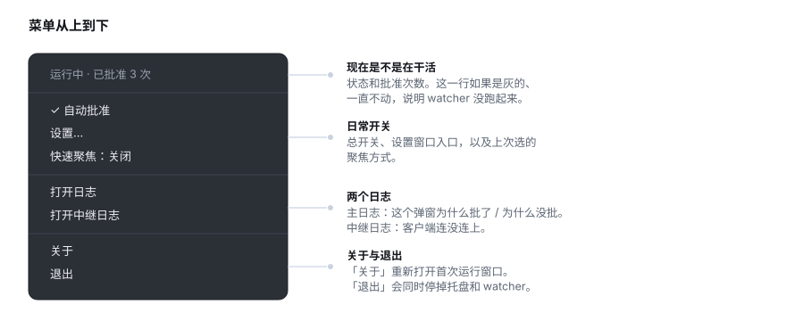
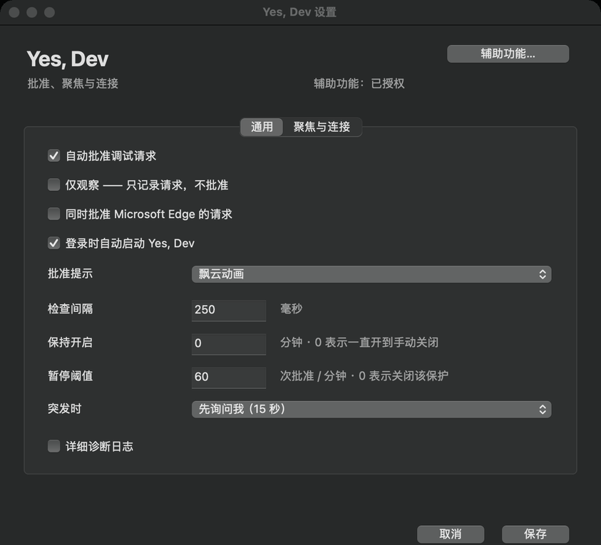
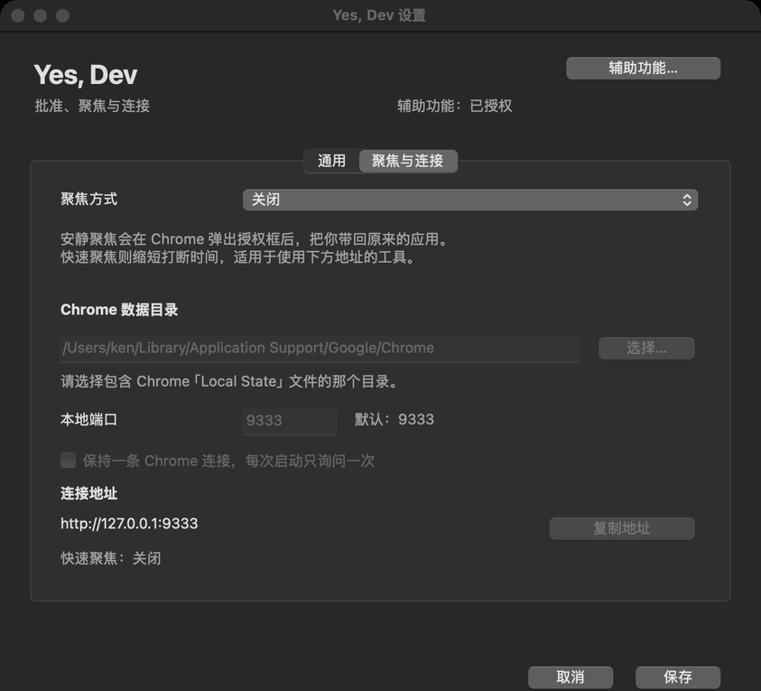

<p align="center">
  
</p>

<p align="center">
  在托盘 / 菜单栏里替你点掉 Chrome 和 Edge 的远程调试授权弹窗。
</p>

本地工具（Playwright、MCP 服务、你自己的脚本）想连浏览器时，Chrome 会弹一个
**「要允许远程调试吗？」** 的面板，等你手动点。Yes, Dev 替你点这一下。
支持 Windows 和 macOS。

> **它只负责回答弹窗，不判断是谁在请求。** 开启期间，任何本地程序都能进来，
> 只在你能接受这一点时才打开它。



## 安装

**Windows** —— [下载 ZIP](https://github.com/Kennems/yes-dev/releases/latest)，
把整个文件夹解压到一个固定位置，双击 `YesDev.exe`。`app/` 和 `runtime/` 要和
exe 放在一起，Python 已经打包在里面了。需要 Windows 10/11 x64 和
PowerShell 5.1。启动器没有签名，SmartScreen 可能问一次。

**macOS** —— 没有提供签名版 `.app`，从源码跑：

```bash
git clone https://github.com/Kennems/yes-dev.git && cd yes-dev
python3 -m pip install -e .
yesdev
```

然后到「系统设置 › 隐私与安全性 › 辅助功能」里给这个 Python 解释器授权。
菜单里的「辅助功能…」会直接打开那个面板。

完整步骤：[Windows](docs/windows.md) · [macOS](docs/macos.md)

## 你会看到什么

首次运行窗口会说明它做什么、需要什么权限、当前是否已经授权。
菜单里的「关于」可以随时再打开它。



跑起来之后，所有入口都在一个菜单里：



## 设置

两个标签页。「通用」是你日常会动的开关：



「聚焦与连接」只在你用中继时才需要关心：



| 设置项 | 作用 |
|---|---|
| **自动批准调试请求** | 总开关 |
| **仅观察** | 只写日志、不点允许，用来先看清楚会批哪些请求 |
| **同时批准 Microsoft Edge 的请求** | 默认只管 Chrome |
| **批准提示** | 飘云动画 / 通知卡片 / 静音 |
| **检查间隔** | 扫描频率，默认 250 毫秒。调大省 CPU，但反应变慢 |
| **保持开启** | N 分钟后自动关闭，`0` 表示一直开到你手动关 |
| **暂停阈值** | 每分钟超过 N 次就自我保护，`0` 表示关掉这个保护 |
| **突发时** | 先询问你，或者直接安静暂停 |

默认值：批准开启、Edge 关闭、250 毫秒、飘云提示、不设定时关闭、每分钟 60 次上限。
到上限时会问「停止」还是「允许一小时」；15 秒不回答就停止。
选「安静停止」的话，大约一分钟后自动恢复。

## 进阶

**Windows —— 每个浏览器只维持一条连接。** 打开「保持一条 Chrome / Edge 连接」，
把 CDP 工具指向 `127.0.0.1:9333`（Chrome）或 `9334`（Edge），后面的客户端会复用
这条连接，不再重复弹窗。[配置与接入](docs/concurrent-relay.md)

**macOS —— 聚焦与中继。** *安静聚焦* 在 Chrome 抢走焦点后把焦点还回去；
*快速聚焦* 在弹窗出现前就准备好归还，但要求工具走中继。两个都默认关闭。
[聚焦行为](docs/macos.md#focus-behavior)

## 不批准了怎么办

先确认托盘还在、**自动批准** 是勾上的、没有处在「仅观察」或暂停状态。然后看日志：

- `%LOCALAPPDATA%\YesDev\yes-dev.log`（Windows）或
  `~/Library/Application Support/YesDev/yes-dev.log`（macOS）—— 某个弹窗
  为什么批了、为什么没批
- 同目录的 `relay.log` —— 只有开了中继才有内容

设置也存在这两个目录里，升级不会丢。**替换程序前先「退出」** —— 正在运行的
那份还在跑旧代码。

它只处理 `chrome://inspect/#remote-debugging` 这个授权模式；命令行参数方式的
远程调试是另一条路，管不了。Windows 版匹配英文和简体中文的弹窗，浏览器标题
一旦改了就需要改代码。

[排障说明](docs/troubleshooting.md)

## 文档

[Windows](docs/windows.md) · [macOS](docs/macos.md) ·
[Windows 中继](docs/concurrent-relay.md) · [排障](docs/troubleshooting.md) ·
[架构](docs/architecture.md) · [测试](tests/README.md) ·
[打包](packaging/README.md) · [更新日志](CHANGELOG.md) ·
[English README](README.md)

（`docs/` 下的细节文档目前是英文。）

## 许可

[MIT](LICENSE)。Windows 便携包里附带了运行时和依赖各自的许可证。
